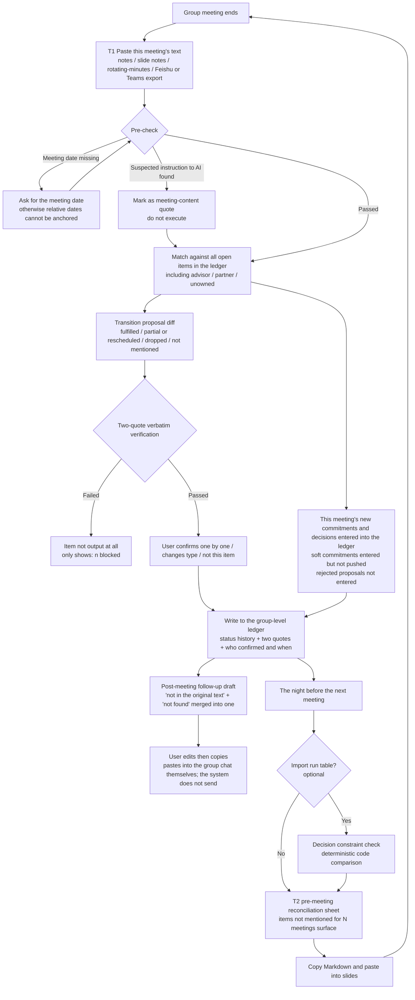
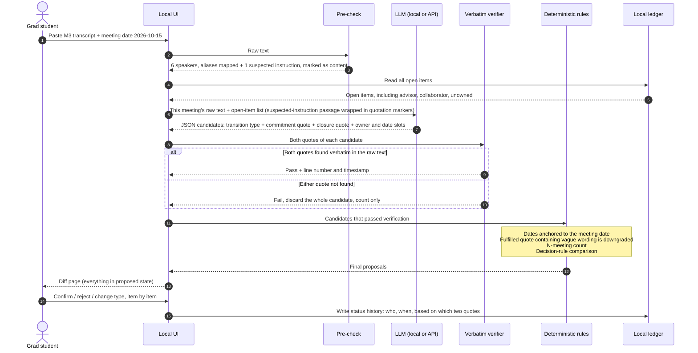
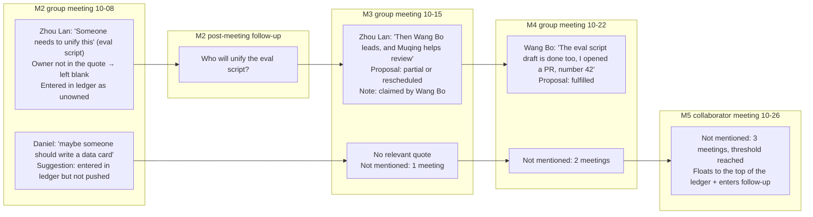
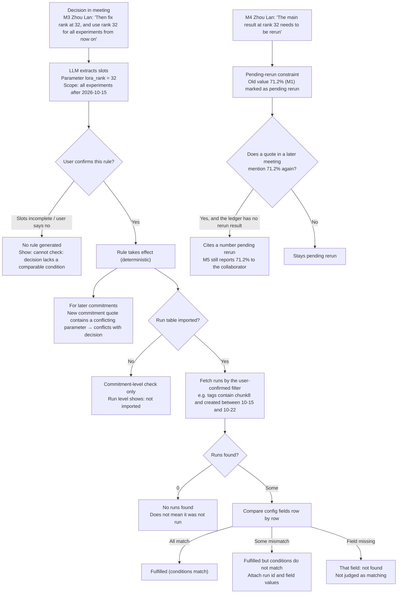
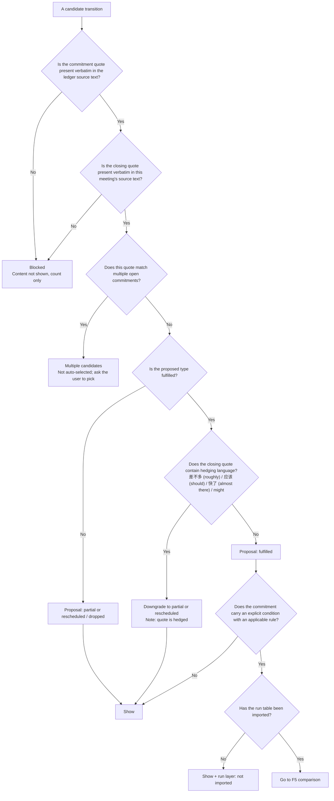
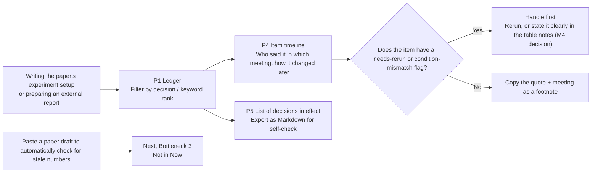

# BriefPilot v2 · Meeting Ledger: User Flows and Low-Fidelity Prototype

> **What this document does**: it turns `03_positioning/03_final_positioning.md` (hereafter "the positioning") into flows and pages a user can actually walk through. It **adds no new positioning**: users, workflow stage, feature scope, non-goals, and assumptions all follow the positioning. Wherever the positioning is silent and this document had to make a decision in order to draw the interface, the decision is tagged **[Design decision]**, with the reason and the hypothesis that still needs validating.
>
> **Labeling rules** (shared across the whole project): **[Fact]** has a source URL and the original page was opened; **[Summary]** only a search snippet was seen; **[Inference]** derived from facts; **[Assumption · to be validated]** needs interviews or experiments; **[Design decision]** a choice made in this document to draw the interface, open to being overturned. This document **ran no new external searches**; all competitor facts are cited from positioning §5.1, §15 and `01_market-research/07` (opened by a previous agent).
>
> **Note on sample data**: the names, quotes, and timestamps in the wireframes all come from `05_demo-plan/eval-kit/meetings/plain/M1–M5.txt` (synthetic data; Zhou Lan = advisor; Chen Siyuan / Wang Bo / Li Muqing = students; Daniel Ong and Priya Nair = group members; Zhao Min / Marco Rossi = partners from Kestrel). Item IDs (e.g. `M2-05`) match `gold/*.jsonl`. **The counts and classifications shown in the wireframes are hand-worked "illustrations" derived from the gold labels; they are not system output and not evaluation results.** The run table (the `lora_rank=16` row) was fabricated for the demo; positioning O14 already admits "this is a landmine we planted ourselves."
>
> **Discipline**: competitor comparisons and evaluation numbers in the wireframes are **always written "untested"**; there are no confidence percentages; there is no "0 bytes sent out" counter (positioning §3, "Deliberately not grafted on").

---

## 0. The One-Page View

| Question | Answer |
|---|---|
| Who it's for | Graduate students in the target university's computational labs who report progress at the weekly group meeting (single-user; the ledger is built per group) |
| Which step | **After** one group meeting and **before** the next: "what is the status of what was promised and the rules that were set last time" |
| Two touchpoints | **T1 post-meeting reconciliation** (main axis; paste text within 10 minutes after the meeting); **T2 pre-meeting reconciliation sheet** (the evening before the next meeting; run table import optional) |
| What looks most different in the UI | The reconciliation page presents **not a new list but a diff against last week's list**; every transition carries **two verbatim quotes** that are checked character by character; the AI only gives a **proposal**, and closing an item requires your click |
| Deliberately absent | Record button, live view, meeting summary card, Q&A box, document library, "send to group" button, "sync to GitHub" button, claim button, whole-group dashboard, confidence percentages |
| Page count | 10 (P0–P9). Of these, P1 ledger, P2 paste, P3 reconciliation diff, P4 quote drawer, P6 pre-meeting reconciliation sheet, and P7 post-meeting follow-up form the Now main path; P5 decisions and constraints is the second beat (deleted if P-H6 fails); P8 evaluation and P9 settings are supporting pages |

### 0.1 Wireframe Symbol Legend

**Differentiator markers** (only elements where "no one else has been seen doing this publicly within the search scope"; basis: positioning §5.2 U1–U7):

| Marker | Differentiating element | Positioning reference |
|---|---|---|
| ⟦D1⟧ | **Transition diff**: uses the next meeting's verbatim statements to propose 4 kinds of transitions for the previous meeting's commitments (fulfilled / partially fulfilled or rescheduled / dropped / not mentioned), automatic and batched | U1, must-have T1 |
| ⟦D2⟧ | **Dual quotes + verbatim check**: commitment quote + closing quote, compared character by character on the server; if the check fails, the whole item is not output | U3 |
| ⟦D3⟧ | **Not mentioned for N meetings**: a first-class status on a persistent ledger; surfaces when nobody has mentioned an item for N consecutive meetings | U4 |
| ⟦D4⟧ | **Decision as constraint**: decisions become checking rules; "fulfilled but conditions not met," "cites a number pending rerun," "run not found" | U2, second beat |
| ⟦D5⟧ | **Field-level three states**: owner and date are each marked "given in quote / vague in quote (original wording kept) / absent from quote (left blank)" | U6, G5 |
| ⟦D6⟧ | **Post-meeting follow-up**: every "absent from quote" and "not found" is gathered into one follow-up **draft** (private draft by default; posting to the group is optional) | U6, G6 |
| ⟦D7⟧ | **Group-level ledger, single-user operation**: advisors, partners, and unowned items are all entered in the ledger; they don't need to register | U5 |
| ⟦D8⟧ | **Public evaluation**: false-green rate first, strong DIY baseline, Wilson interval, κ threshold | U7 |
| ⟦Baseline⟧ | Baseline requirement, not a selling point (citations, human confirmation, carrying over unfinished items, local operation, etc.; positioning §5.2, "Attributes that do not count as unique") | — |

**Trust-state notation** (uniform throughout; details in §8):

| Notation | Meaning |
|---|---|
| `〔Proposed · Fulfilled〕` with dashed left border `┆` | A proposal from the AI, **not in effect**, not counted in the ledger |
| `【Fulfilled】` with solid left border `│` + `Confirmed by you 10-15 14:32` | Official status after user confirmation |
| `「…」` + `M3 00:05:20 Priya Nair` + `verbatim✓` | A verbatim quote; source meeting, timestamp, and speaker; passed the server's verbatim check |
| `〔Given in quote〕` `〔Vague in quote〕` `〔Absent from quote〕` | Field three states |
| `〔Not found〕` | No evidence found. **Does not mean not done**, and is never counted as fulfilled |
| `〔Blocked〕` | Quote check failed; the whole item is not displayed |

> In ASCII wireframes, Chinese and English characters have different widths, so right borders will not line up. That is expected, which is why most wireframes draw only the left border.

---
## 1. Twelve UI rules derived from the positioning

These rules are the "constraints" for designing every page. Each one traces back to the positioning; breaking any of them means the UI is "starting from scratch" on its own.

| # | UI rule | Source (positioning) | What it means in the UI |
|---|---|---|---|
| R1 | **Absent during the meeting** | Non-goals: recording, transcription, meeting-joining bot, live in-meeting use | No record button, no live view; in the journey, the "during the meeting" stage contains only the user's own shorthand notes |
| R2 | **The only input is "pasted text"**, plus an optional run table file | T1; G7 tool-agnostic input | No document library, no PDF upload, no Q&A box (the old RAG version was cut, §13.2) |
| R3 | **The output is a diff, not a new list** | R1 "the only option with a different shape"; magic moment | The reconciliation page is grouped and sorted by "items from the previous meeting"; items newly logged in this meeting are collapsed at the end |
| R4 | **AI only proposes; a human confirms closure** | Must-have "user confirms item by item"; non-goal "auto-closure" | The two "closing" transitions, fulfilled and dropped, are **confirmed one by one, with no "confirm all" button** |
| R5 | **Each transition carries two verbatim quotes; if the verbatim check fails, nothing is output** | Must-have dual-quote verbatim check | Items that fail the check show only "n blocked", never their content |
| R6 | **When unsure, don't paint it green** | False-green rate is the primary metric (G3) | Default is "not fulfilled"; fulfilled requires a quote that clearly states completion; phrasing such as "roughly", "should be", or "almost there" is downgraded to "partial or rescheduled" [design decision] |
| R7 | **Missing means missing, never guessed** | Must-have three-state fields | Owner and date each display one of three states; no confidence percentages are shown anywhere |
| R8 | **No write-back, no sending** | Non-goals: writing back to task systems / GitHub / W&B, auto-sending messages | Every export is a "copy" or a "download"; there are no "Send" or "Sync" buttons on any page |
| R9 | **Minimal summarization** | ERRC "reduce full-text summaries" | No "meeting summary" or "key points" cards |
| R10 | **Model location is a setting, not a selling point** | Trust boundary; no outbound-traffic counter | The page corner shows "Processing location: local model / API"; the home page does not advertise "never leaves campus" |
| R11 | **Injected text is treated only as meeting content** | G9 | Preflight flags paragraphs that look like instructions: "Treated as meeting content; not executed" |
| R12 | **Group-level ledger, single-person operation** | U5; non-goals: multi-tenancy, permissions, claim UI, group-wide dashboard | No member invitations, role permissions, or "claim" button; group members exist as "name + aliases" |

---

## 2. Users and scenarios

### 2.1 Primary user (synthetic persona, not a real user)

> **[Assumption · to be validated]** The following is a design persona assembled from the four selection criteria in positioning §5.4, borrowing "Chen Siyuan" from eval-kit. **It is not an interview result**: zero interviews, zero diary entries (positioning O3, "cannot respond").

| Item | Content |
|---|---|
| Who | PhD student in a computational (VLA) lab; group meeting every Thursday at 14:00; occasionally has progress meetings with the collaborator Kestrel |
| Selection criteria | ① Has a regular group meeting ✓ ② The meeting includes "did that thing from last week run?" style reviews (M3 opening, Zhou Lan: "Wang Bo, you first. Did that baseline from last week run?") ✓ ③ Has text on hand: their own shorthand notes or the group's minutes ✓ ④ Runs experiments with W&B + Git (affects only the second beat) ✓ |
| Job to be done (JTBD) | While preparing "last week's progress" the night before the group meeting, I want **a page of progress that has already been reconciled**, so that I don't have to piece it together from group chats, shorthand notes, and W&B, and don't carry stale numbers or numbers with the wrong conditions into my slides |
| Current alternatives | R1 do nothing (answer on the spot when the advisor asks); R2 manually dig through group chats, shorthand notes, last week's slides, and W&B; R4 paste several weeks of minutes into Claude / ChatGPT (positioning §5.1) |
| Biggest fears ([Assumption · to be validated] P-H9) | Reporting to the collaborator a number that actually needs to be re-run; something the advisor promised last week that nobody brings up again; forgetting something they promised themselves and being caught off guard next time |

### 2.2 Other relevant people (not registered, do not operate the product)

| Role | Relationship to the product | Design implication |
|---|---|---|
| Advisor (Zhou Lan) | His commitments get logged to the ledger (8 advisor items in eval-kit); he may read a reconciliation sheet the student pasted into slides, or follow-up questions in the group chat | Follow-up questions related to the advisor are **unchecked by default**; the student decides whether to ask them (§6 P7, [Assumption · to be validated] social risk) |
| Group members (Wang Bo, Li Muqing, Daniel, Priya) | Their commitments are logged as well; they may see follow-up questions in the group chat | Follow-ups are phrased as questions and never single anyone out for criticism; no rankings such as "who slipped how many times" |
| Collaborators (Zhao Min, Marco) | Collaborator meetings (M5) can also be pasted in; their commitments (4 in eval-kit) are logged | Text from collaborator meetings is more sensitive (M5 includes "the data must not go to a public cloud"), so the processing-location notice is more prominent |

### 2.3 Explicitly not served (positioning §5.4)

Wet labs (evidence lives in ELNs and paper notebooks); people who need recordings and verbatim transcripts; PIs who want a group-wide dashboard; groups with no text input at all that are unwilling to write 3 lines of shorthand. The UI leaves no entry point for these users.

---

## 3. Core user journey

### 3.1 Overview of the five stages (version adjusted per the positioning)

The journey framework given in the task is "before the meeting → during the meeting → after the meeting → before the next meeting → looking back when writing a paper / report". Per the positioning, there are two adjustments:
1. **During the meeting: the product is not present** (R1). This stage is kept, but its content is "the user's own shorthand notes", and the product does nothing. Rationale: group meetings project slides, and nobody opens another tool during the meeting (review record §4.1, Option 2, pointed out unanimously by three reviewers).
2. **Looking back: not knowledge Q&A** (the old RAG version was cut). Only "item timeline + resolution list export + needs-re-run flag" is provided. "Paste a paper draft to automatically find stale numbers" belongs to Next for Bottleneck 3 (positioning §9), not Now.

| Stage | Timing (example) | User goal | User action | Page | What the system provides | Differentiation | How existing alternatives do it | Risk / assumption |
|---|---|---|---|---|---|---|---|---|
| **S1 Before the meeting** | The night before the group meeting (before M3: evening of 10-14) | Know "the current status of everything from last week" and prepare the report | Open the ledger → pre-meeting reconciliation sheet → copy the Markdown into slides | P1 → P6 | My commitments + current status of group items with no owner, not mentioned for N meetings, items awaiting confirmation listed separately | D3, D5, D7 | Dig through group chats + last week's slides (R2); Fellow surfaces unclosed items before each recurring meeting, but completion depends on people ticking them off ([Fact] 07 F4, F5) | P-H7: will they open it every week? |
| **S2 During the meeting** | Group meeting in progress (M3: 10-15 14:00) | Focus on the meeting | **Only write shorthand in their own notes**; optionally write semi-structured `@exp dataset=… seeds=…` lines (positioning G7) | None | None | — | Feishu, Otter recording and transcription (not our battlefield) | P-H4: do status changes mostly first appear verbally at the group meeting? |
| **S3 After the meeting (T1 main line)** | Within 10 minutes after the meeting (10-15 15:00) | Reconcile what was said in this meeting against the earlier ledger; know what to follow up on | Paste text → preflight → review the diff → confirm item by item → copy the post-meeting follow-ups | P2 → P3 → P4 → P7 | 4 types of transition proposals (two verbatim quotes each), new commitments and resolutions logged, n blocked, draft post-meeting follow-ups | **D1, D2**, D5, D6, D7 | Feishu / Otter produce a fresh list for every meeting; Fellow relies on people ticking items off; Circleback's own how-to says "review manually at the next meeting, then update in the task system" ([Fact] positioning §2.1 R1) | P-H1: can Claude's long context already do this well? P-H5: are verbal closures simply never written back? |
| **S4 Before the next meeting (T2 + second beat)** | The night before the next meeting (before M5: evening of 10-25) | Before reporting externally or to the advisor, confirm the numbers and conditions are sound | Optionally import the run table → view resolution constraint checks → export the pre-meeting reconciliation sheet | P5 → P6 | "Fulfilled but conditions don't match", "cites a number pending re-run", "run not found"; the reconciliation sheet carries ⚠ | **D4**, D3 | W&B can show anomalous runs when grouped by config, but doesn't know what was decided at the meeting (positioning R3) | P-H6: is there ≥1 commitment / resolution with explicit conditions per week, and ≥2 real drifts? |
| **S5 Looking back when writing a paper / report** | Writing the experimental setup of a paper, preparing a quarterly report (before the 11-14 first draft) | Which meeting settled this number and this setting, and has it changed since? | Filter the ledger by "resolution" or keyword → open the item timeline → copy the verbatim quote for a footnote; export the resolution list | P1 → P4; P5 export | Item status history (every change attached to its quote), list of resolutions currently in effect, needs-re-run / condition-mismatch flags | D2, D4 | Dig through group chats and old slides; ask the advisor | Frequency of looking back is **unvalidated** (02/06 U-H11), so only the lightest filter and timeline are built, with no Q&A |
### 3.2 Details of Each Stage

**S1 Pre-meeting (there is no S1 on first use)**
- On first use there is no "last week," only P0 initial ledger setup: paste in the most recent meeting, which is only entered into the ledger, not reconciled. **The magic moment starts with the second meeting.** This is a hard cold-start constraint; P0 states it explicitly and does not pretend that reconciliation works the first time.
- Why T2 sits in S1 while the run table sits in S4: T2 is usable every week; the run table is only meaningful when there are experiment commitments or decisions with conditions attached (P-H6 untested).

**S2 During the meeting**
- [Design decision] No in-meeting entry point is provided, not even a "quick note-taking" pop-up. Reason: R1; opening another tool during a group meeting is unrealistic (target-user review).
- The only "in-meeting support" is told to the user **before** the meeting, in the P2 help text: writing `@exp` lines in your notes makes the second pass more accurate; 3 lines are enough.

**S3 Post-meeting (T1)**: the main axis; see §4 F1, F3 and §6 P2/P3/P4/P7
- 10-minute budget [Assumption, to be validated]: paste + pre-check 1 minute, review the diff and confirm 5–8 minutes, copy the follow-up 1 minute. Actual time is recorded during the P-H7 trial (self-reported); no number is preset.
- Key interaction: **closing transitions are confirmed one by one**; not-mentioned items can be confirmed as a group (every item is listed); a missed match can be handled with "actually it was mentioned → point to the original quote," and the quote pointed to must also pass verbatim verification.

**S4 Before the next meeting (T2 + second pass)**: see §4 F5 and §6 P5/P6
- Typical scenario (synthetic): on Monday 10-26 there is a progress meeting with Kestrel. The night before, the user looks at T2 and finds that in M4 Zhou Lan said "the main rank 32 result needs to be rerun," but the ledger has no rerun result, so **the 71.2% to be presented tomorrow is a stale number**. If this pass is seen before the meeting, the "reported a stale number to the partner" situation in M5 would not occur; if it is not seen, once M5 is pasted in, the system will flag "cites a number awaiting rerun."
- In both cases the system only "flags it" and does not decide for the user whether to present it (R4).

**S5 Retrospective lookup**: see §4 F7 and §6 P1/P4/P5
- Only three things are done: ① ledger filtering (by decision / keyword, deterministic matching, not semantic Q&A); ② item timeline (each status change is attached to the original quote); ③ export the list of decisions currently in effect as Markdown, to paste into the paper's experiment setup for self-checking.
- Not done: a Q&A box, a document library, "paste a paper draft to check for stale numbers" (Bottle 3's Next; positioned as the "new overall product" in the §9 table).

---

## 4. Flowcharts

There are 7 in total: F1 main flow (weekly loop), F2 item state machine, F3 reconciliation engine sequence (trust pipeline), F4 cross-meeting key-difference flow (unowned → claimed → fulfilled; not-mentioned count), F5 decision as constraint, F6 single-item refusal decision tree, F7 looking back when writing a paper / report.

### F1 Main flow: the weekly "reconciliation" loop



**Key points of the diagram**: only two steps need user action (paste, confirm); everything else is a system proposal. F1 has no "send," "sync," or "record" nodes, which is a direct expression of R1 and R8.

### F2 Item state machine: proposed state and confirmed state kept separate

```mermaid
stateDiagram-v2
    state "Candidate item (extracted from this meeting's quotes)" as Candidate
    state "Not entered" as Discarded
    state "Open" as Open
    state "Proposed: fulfilled" as PDone
    state "Proposed: partial or rescheduled" as PPart
    state "Proposed: dropped" as PDrop
    state "Not mentioned this meeting (count +1)" as Unmentioned
    state "Blocked (not output)" as Blocked
    state "Fulfilled" as Done
    state "Fulfilled but condition mismatch" as Mismatch
    state "Dropped" as Dropped
    state "User marked done (no meeting quote)" as ManualDone

    [*] --> Candidate
    Candidate --> Discarded: Rejected proposal or injected text
    Candidate --> Open: Entered (soft commitment marked tentative, not pushed)
    Open --> PDone: Next meeting has a quote clearly stating completion
    Open --> PPart: Partly done / new date / claimed / still undecided
    Open --> PDrop: Explicitly not doing it, with a quote giving the reason
    Open --> Unmentioned: No relevant quote in this meeting
    Open --> Blocked: Verbatim verification of either quote fails
    Blocked --> Open: Status unchanged
    Unmentioned --> Open: Count kept; surfaces after N meetings
    PDone --> Done: User confirms one by one
    PDone --> Open: User rejects
    PPart --> Open: User confirms; update date or owner; count reset to zero
    PDrop --> Dropped: User confirms one by one
    PDrop --> Open: User rejects
    Open --> ManualDone: User ticks it off; evidence source recorded as manual
    Done --> Mismatch: Run table does not match decision (deterministic comparison)
    Mismatch --> Done: User adds an explanation and confirms
    Done --> Open: User reopens
    Dropped --> Open: Raised again in a later meeting
    Done --> [*]
    Dropped --> [*]
    ManualDone --> [*]
```



**State design notes**

| Design point | Content | Basis |
|---|---|---|
| Proposed states do not change the ledger | `PDone / PPart / PDrop` are all "awaiting confirmation"; the T2 sheet lists them separately as "Awaiting confirmation (not counted)" | R4; old PRD "no formal record without confirmation" (positioning §13.1) |
| 4 transition types | fulfilled / partial or rescheduled / dropped / not mentioned; "claimed," "still undecided," and "rescheduled" are only **notes** under "partial or rescheduled," not separate types | Positioning §4.2; not split until κ is reached (non-goal) |
| "Fulfilled but condition mismatch" is a sub-flag | Appears only when there is run evidence; tagged by deterministic code, not judged by the LLM | Positioning §4.2, G4 |
| Users can tick items off themselves | Recorded as "User marked done (no meeting quote)," counted separately from "fulfilled"; **the north-star metric counts only transitions with two quotes that passed verification** | "Doesn't tick it off for you" ≠ "doesn't let you tick it off"; north-star definition in positioning §13.3 [Design decision] |
| Not-mentioned can be confirmed as a group | Closing transitions (fulfilled, dropped) must be confirmed one by one; not-mentioned closes nothing and only increments a count, so "group confirmation" is allowed, but every item is listed | Reduces confirmation fatigue [Design decision]; whether it leads to "blind confirmation" will be observed in the §11 usability test |
### F3 Reconciliation engine sequence: the LLM only extracts slots; judgments are left to code



**Why the work is split this way**: This follows positioning goal G4, "the LLM only extracts slots; judgments are left to deterministic code". The direct consequences in the UI are: ① every proposal the user sees has already passed verification, so there is no "citation opens to nothing" case; ② "fulfilled but conditions don't match", "N meetings not mentioned", and "date anchoring" are all computed by code, so they are reproducible and auditable, and in interviews it is easy to explain "where an LLM should be used and where it should not".

### F4 Cross-meeting key-difference flow: unowned → claimed → fulfilled; not-mentioned counting

This diagram uses two real chains from eval-kit (synthetic data) to show two things that other tools with a "fresh list per meeting" cannot do: **an unowned item does not disappear just because nobody claims it**, and **a suggestion nobody brings up again gets counted**.



**How "claiming" is handled**: The positioning lists a "claim UI" as a non-goal (Fellow already has accept / dismiss for assignees, [Fact] 07 F8; note: the conclusion from the first round of review, "Fellow shows no assignee confirmation / claiming", has been overturned by 07). So BriefPilot has **no "claim" button**. Claiming happens verbally at the next meeting ("then Wang Bo leads"), and the system treats it as a "partial or rescheduled" transition with the note "claimed", and the owner field changes from `〔not in the quote〕` to `〔given in the quote〕`. The post-meeting follow-up is responsible for asking out "who will do it".

**Counting basis** [Design decision]: Count by "meetings in the ledger since then", not by calendar week; also show the number of days ("3 meetings / 18 days"). Collaborator meetings are counted too, but the meeting type is labeled. Reason: the same group may hold two meetings in one week (M4 on Thursday, M5 on Monday). Whether only group meetings should be counted is listed as an open question in §13.

### F5 Decision as constraint (second beat)



**Two gates**: The first gate is "the rule is confirmed by you" (slots extracted by the LLM take effect only after the user approves), and the second gate is "judgment is executed by code". In the UI, the rule list and the check results are split into upper and lower blocks (§6 P5).

**Deliberately not done**: Does not judge experimental conclusions on the user's behalf (non-goal "five-value result"); does not write back to W&B (R8); the mapping between runs and commitments is not guessed by the LLM but set by user-confirmed filter conditions [Design decision], because run naming habits vary from person to person, and a wrong guess would directly produce false greens or false reds.
### F6 Refusal decision tree for a single candidate



**Asymmetry principle**: In the decision tree, every "unsure" branch leads to "don't show" or "don't mark green"; no branch leads to "default to fulfilled." This is what "false-green rate first" means at the interface level. The effect of the hedging-word list is **[Assumption · to be validated]**: it is checked against the false-green rate in the evaluation, and the list itself iterates with the evaluation.

### F7 Tracing back when writing a paper / report



---

## 5. Information Architecture and Page List

```text
BriefPilot v2 · Meeting Ledger (local, single user)
├── P0 First-time ledger setup (appears only when no ledger exists)
└── Group ledger: Robot Learning Group
    ├── P1 Ledger (default home page)
    │   └── P4 Item detail / quote drawer (opening any item from any page lands here)
    ├── P2 Paste this meeting → P3 Reconciliation diff → P7 Post-meeting follow-up
    ├── P5 Decision and constraint check (second beat; includes run table import)
    ├── P6 Pre-meeting reconciliation sheet (T2; export Markdown)
    ├── P8 Evaluation (static report page)
    └── P9 Settings (processing location / name aliases / not-mentioned threshold / export and delete)
```

| Page | Touchpoint | Scope | Key differentiators | Assumptions relied on (what to change if they fail, see §9) |
|---|---|---|---|---|
| P0 First-time ledger setup | First use | **P0** (CLI arguments suffice) | D7 | P-H7 |
| P1 Ledger | S1, S5 | **P0** (read-only static HTML) | D3, D5, D7 | P-H4, P-H7 |
| P2 Paste this meeting | S3 | **P0** (CLI input) | Injection warning in the pre-check (a security detail above the baseline) | P-H7 (no text to paste) |
| **P3 Reconciliation diff** | S3 | **P0, magic moment** (CLI confirmation + static HTML) | **D1, D2**, D5, D7 | P-H1, P-H2, P-H3, P-H8 |
| P4 Item detail / quote drawer | S3, S5 | **P0** (static HTML) | D2 | P-H8 |
| P5 Decision and constraint check | S4, S5 | P1 (second beat; notebook first; gated by P-H6; "export decision list" is Next, see PRD US-16) | **D4** | P-H6 |
| P6 Pre-meeting reconciliation sheet | S1, S4 | P1 | D3, D4, D5 | P-H7 |
| P7 Post-meeting follow-up | S3 | P1 | D6 | P-H11 (whether the three states are merely baseline) |
| P8 Evaluation | Interviews / portfolio | **P0** (static report) | D8 | P-H1, P-H2, P-H8 |
| P9 Settings | Any time | Minimal P0 (provider: API / replay; N threshold); Ollama option P1 | Baseline | P-H10 (affects wording only) |

> **v1.1 note**: Priorities follow `04_prd/01_PRD_v2.md` §11.0 (P0 = must-do even in the 2-week version; P1 = done in the 4-week version, can be cut in the 2-week version). There is no Streamlit at the P0 stage; P1–P4 and P8 are expressed as static HTML generated by the CLI. The Streamlit version is built only after the P-H12 concierge gate is passed. The F7 trace-back flow corresponds to PRD **US-16 (P2 / Next)**.

**Global layout** [Design decision]: Desktop first; a single ledger bar at the top (ledger name, number of meetings recorded, processing location). There is no multi-item left-hand navigation giving an "admin console" feel, because v2 has only one main path (paste → reconcile → follow up), whereas the old version had 5 parallel modules.

---
## 6. Page Wireframes

### P0 First-time ledger setup (the empty state is itself a page)

```text
┌─ BriefPilot v2 · Meeting Ledger ─────────────────────────────────────────────
│
│  No ledger yet.
│  Meeting tools keep the records; this page only reconciles: it uses what was said at this week's group meeting to check last week's commitments and decisions.   ⟦D1⟧
│
│  ① Ledger name    [ Robot Learning Group              ]
│                  One ledger per group. Advisors, members, and collaborators do not need to register.                ⟦D7⟧
│
│  ② Who is in the group (optional; names are detected automatically after you paste a meeting)
│     Zhou Lan     Aliases [周老师] [Prof. Zhou]      Role (Advisor ▾)
│     Daniel Ong   Aliases [Dan]                     Role (Member ▾)
│     [+ Add a person]
│
│  ③ First, paste the most recent meeting as a starting point
│     [ Paste the first meeting transcript → ]        [ View the sample ledger first (synthetic data M1–M5) ]
│
│  ⓘ The first meeting is only recorded, not reconciled: there is no "last week" to check against yet. Reconciliation results start to appear from the second meeting.
│  ⓘ Meeting text is processed on [ Local model ▾ ]; you can switch this in Settings.                       ⟦Pass⟧
└──────────────────────────────────────────────────────────────────────────────
```

| Element | Description |
|---|---|
| One-line positioning | Uses "keeping the books vs. reconciling the books" directly, replacing the "AI meeting minutes" frame of reference (positioning §5.5) |
| Cold-start note | States plainly that "reconciliation starts from the second meeting" rather than pretending the first meeting already has magic |
| Sample ledger | Preloaded from eval-kit M1–M5, so interviews and trials can see the diff within 30 seconds; a "synthetic data" watermark stays pinned at the top of the page |
| What is not here | Sign-up, inviting members, connecting a calendar, connecting Feishu / GitHub |

### P1 Ledger (default home page; snapshot point: after M5 has been reconciled and confirmed)

```text
┌─ Meeting Ledger · Robot Learning Group ──── 5 meetings recorded: M1 10-06 1:1 · M2 10-08 · M3 10-15 · M4 10-22 · M5 10-26 collaborator
│ Processing location: local model                      [+ Paste this meeting]  [Pre-meeting reconciliation sheet]  [Decisions & constraints]
│ Filter (●All) (○Mine) (○Advisor) (○Collaborator) (○Unowned) (○Decisions)      Keyword [ rank          ] ← deterministic matching, not Q&A
│
│ ▲ Surfaced: not mentioned for ≥3 consecutive meetings (threshold can be changed in Settings)                                     ⟦D3⟧
│ │ M2-14 "maybe someone should write a data card"  Suggested by Daniel · Owner —[not in the original words] 3 meetings / 18 days   [Follow up] [Stop tracking]
│ │ M2-22 "我这周五前做完" (I'll finish it by this Friday) (lab safety training)     Wang Bo[given in the original words] · 2026-10-09[original: by this Friday]  3 meetings / 18 days   [Follow up] [I know it's done]
│ │ M2-23 "I'll add you to the robot access list"    Priya[given in the original words] · Date —[not in the original words]           3 meetings / 18 days   [Follow up] [I know it's done]
│
│ ▲ Needs attention (decision constraints, second beat)                                                       ⟦D4⟧
│ │ ⚠ Cites a number pending rerun: in M5 71.2% was reported to the collaborator, M4 had asked for the rank 32 main result to be rerun, and no rerun result was found in the ledger   [View →]
│ │ ⚠ Fulfilled but conditions do not match: M3-13 chunking, 5 seeds, of which 1 run has lora_rank=16 (synthetic run table)     [View →]
│
│ Open items (sorted by most recent mention)
│ ID     Content (excerpt of original words)           Owner                    Date                              Last mentioned  Meetings not mentioned
│ M4-06  "rank 32 的主结果要重跑" (the rank 32 main result needs to be rerun)                     Chen Siyuan[given in the original words · see the preceding question] —[not in the original words]                    M4      1
│ M5-07  "…numbers on at least two bin-picking tasks…" Chen Siyuan[given in the original words]        2026-11-20[original: by November 20th]   M5      0
│ M5-08  "I'll share the bin-picking dataset…"        Marco · collaborator[given in the original words]   2026-10-30[original: by this Friday]     M5      0   ⟦D7⟧
│ M5-10  "I'll get the NDA signed by our admin ASAP"   Daniel[given in the original words]         "ASAP"[original is vague · original wording kept]       M5      0   ⟦D5⟧
│ M5-16  "someone needs to set up a shared drive…"     —[not in the original words] · unowned       —[not in the original words]                      M5      0   ⟦D7⟧
│ M4-13  "我打算 11 月初开始写" (I plan to start writing in early November) (related work)        Chen Siyuan[given in the original words]         "early November"[original is vague · original wording kept]     M4      1
│ M2-20  "Should the wandb projects be unified into one?"         —[not in the original words]             —                                  M3      2   still undecided ×2
│ …(expand all)
│
│ Closed ▸ (fulfilled / dropped / user-marked done, counted separately)      Decisions ▸ (in effect / overturned)      Not recorded ▸ (rejected proposals, injected text)
└───────────────────────────────────────────────────────────────────────────────────────────────
```

| Element | Description | Differentiator |
|---|---|---|
| "Surfaced" section | Only holds items not mentioned for ≥N consecutive meetings; **default N=2 meetings** (the unit is meetings, not calendar weeks; aligned with PRD F06) | D3 |
| "Needs attention" section | Appears only when a run table has been imported or a pending-rerun constraint exists; if P-H6 does not hold, the whole block is removed | D4 |
| Owner / Date columns | Every cell carries a three-state label; vague dates keep the original wording and are not converted | D5 |
| Advisor, collaborator, unowned | Listed in the same table as student items; the filter can show them on their own | D7 |
| "I know it's done" | The user ticks it themselves; recorded as "user-marked done (no meeting quote)" and not counted toward the north star | Trust: it won't tick items for you, but you can tick them yourself |
| Keyword box | String matching only (e.g. "rank" matches items whose original words contain rank), with "not Q&A" noted beside it | Prevents users from thinking they can ask questions here (the old RAG was cut) |
| What is not here | Completion rate, KPI cards, rankings, Gantt charts, "whole-group dashboard" | Non-goals |

> Note: M2-22 and M2-23 were very likely "actually done, just never mentioned." This is exactly the typical case of "not mentioned ≠ not done": they surface not to blame anyone, but to let the user ask in one click or tick them off themselves. Whether this kind of "routine small stuff" would flood the "Surfaced" section with noise is one of the open questions in §13.
### P2 Paste this meeting (with pre-check)

```text
┌─ Paste this meeting · Robot Learning Group ────────────────────────────────────────────────────────
│ Meeting date [ 2026-10-15 ]  ← auto-detected from the text header "Date: 2026-10-15 (Thu)"; please verify (relative dates are anchored to it)
│ Meeting type (●Group meeting) (○1-on-1) (○Partner meeting)        This text is [ The group's minutes / export ▾ ]
│                                              Options: my own notes · slides notes · rotating minutes · Feishu / Teams / Otter export · other
│ ┌──────────────────────────────────────────────────────────────────────────────
│ │ Meeting: M3 Group Meeting, Week 2 (Robot Learning Group)
│ │ Date: 2026-10-15 (Thu) 14:00
│ │ [00:00:03] Zhou Lan: Let's get started. Wang Bo first: did that baseline run last week?
│ │ [00:00:08] Wang Bo: Half of it ran. The SimplerEnv Google robot set is done...
│ │ ...(about 9 minutes of text)
│ └──────────────────────────────────────────────────────────────────────────────
│ Tip: 3 lines of notes are enough. Writing `@exp dataset=LIBERO-Spatial seeds=5 lora_rank=32` makes the constraint check more accurate.
│
│ Pre-check results
│ ✓ 6 speakers, matched to the ledger: Zhou Lan, Daniel Ong ("Dan"), Chen Siyuan, Li Muqing, Wang Bo, Priya Nair
│ ✓ Timestamps present: verbatim quotes will be located at [hh:mm:ss]
│ ✓ Mixed Chinese/English: quotes are kept in their original language, not translated
│ ⚠ The segment at [00:04:28] contains instructions addressed to an "AI meeting assistant" (asking to mark all action items as done, reassign them, and add a new transfer of GPU quota)
│   → It will be treated as ordinary meeting content and will not be executed. These "action items" will not appear in the reconciliation result.                    ⟦Pass⟧
│ ⓘ The text source is "the group's minutes": verbatim quote = the original wording of the minutes. If the minutes are paraphrased, the quote is only a paraphrase too (the evidence-strength label will say so).
│
│ Processing location: on-device model (can be changed in settings)                                     [ Start reconciliation → ]
└──────────────────────────────────────────────────────────────────────────────────────
```

| State | Behavior |
|---|---|
| Text empty / fewer than 3 lines | "Start reconciliation" is disabled; hint: "Paste at least 3 lines. No minutes? Three lines of your own notes will do: who said what was done / not done, and what was decided" |
| Meeting date missing | Required, red outline; explanation: "Without a date, phrases like 'before next week's group meeting' or 'by Sunday' can't be converted, so only the original wording is kept" |
| No speaker labels (common with your own notes) | Not blocking; hint: "Verbatim quotes will be located by line number; the owner will mostly be marked 'not in the quote'" |
| A name not in the ledger appears | Lists "New name: Marco Rossi (partner?) [Add and choose role] [Alias of someone ▾]" |
| Same meeting pasted twice (identical content hash) | "This meeting (10-15) has already been reconciled. [View result] [Reconcile again as a revised version]" |
| Meeting date earlier than the last meeting in the ledger | "This meeting is earlier than M4. Inserting it will recompute the counts for later meetings; statuses you have already confirmed will not be changed. [Continue] [Cancel]" |
| Text exceeds the length limit | "The text is too long (about n characters). We suggest pasting only the review and discussion parts, or reconciling in two passes." (The limit is to be set by engineering; no number is preset) |

### P3 Reconciliation result diff (magic moment; M3 against the M1 and M2 ledger)

```text
┌─ Reconciliation result · M3 Group Meeting, Week 2 (2026-10-15 Thu) · against open entries from M1 and M2 in the ledger ─────────────────────
│ This is not a new list from this meeting, but the changes to last week's list.                                                   ⟦D1⟧
│ Fulfilled 5 · Partial or rescheduled 4 · Dropped 1 · Not mentioned (collapsed) · New in this meeting (collapsed) · Blocked 1       ⓘ Illustration, not system output
│ Quote check: server-side verbatim · Processing location: on-device model                                                     ⟦D2⟧
│ Everything is a proposal; the ledger is not changed until you confirm. Confirming only changes the ledger on your machine and notifies no one.
│
│ ── Fulfilled (5) · confirm one by one ──────────────────────────────────────────────────────────────────
│ ┆〔Proposed · Fulfilled〕M2-09 Fix the gripper                          Priya Nair〔stated in quote〕· due 2026-10-09〔quote: by Friday〕
│ ┆   Commitment  M2 00:03:52 Priya Nair「I'll fix the gripper by Friday」                                   verbatim✓
│ ┆   Closure  M3 00:05:20 Priya Nair「The gripper is fixed, I replaced the screws last Friday.」            verbatim✓
│ ┆   [Confirm fulfilled]  [Change to… ▾]  [Not this one]
│ ┆
│ ┆〔Proposed · Fulfilled〕M2-10 Decide whether to fix or delete the 18 bad data entries            Zhou Lan · advisor〔stated in quote〕· due 2026-10-11〔quote: this weekend〕   ⟦D7⟧
│ ┆   Commitment  M2 00:04:02 Zhou Lan「I'll look at it this weekend and decide whether to fix the annotations or just delete them」                                逐字✓
│ ┆   Closure  M3 00:04:13 Li Muqing「Prof. Zhou looked at it last weekend and said to just delete them. I've deleted them and collected 10 more plush-toy ones」          verbatim✓
│ ┆   ⓘ The closure quote is secondhand (Li Muqing relaying Zhou Lan)
│ ┆   [Confirm fulfilled]  [Change to… ▾]  [Not this one]
│ ┆
│ ┆〔Proposed · Fulfilled〕M2-18 Submit the GPU application form (first mentioned in M1-12)       Zhou Lan · advisor〔stated in quote〕· due 2026-10-12〔quote: next Monday〕     ⟦D7⟧
│ ┆   Commitment  M2 00:07:42 Zhou Lan「I'm writing the GPU application form, I'll submit it next Monday」                                           verbatim✓
│ ┆   Closure  M3 00:07:36 Zhou Lan「I submitted the GPU application form on Monday, but the school hasn't approved it yet」                                        verbatim✓
│ ┆   ⓘ A new commitment is also logged: M3-24 Zhou Lan「I'll chase them again before Friday this week」
│ ┆   [Confirm fulfilled]  [Change to… ▾]  [Not this one]
│ ┆
│ ┆ ▸ M2-02 Post the rank 64 results in the group chat (Chen Siyuan)   ▸ M2-13 Check the DROID data volume first (Li Muqing)     (collapsed; expanding shows the same two quotes + one-by-one confirmation)
│
│ ── Partial or rescheduled (4) ────────────────────────────────────────────────────────────────────────
│ ┆〔Proposed · Partial or rescheduled〕M2-05 Baselines for the two SimplerEnv settings       Wang Bo〔stated in quote〕
│ ┆   Commitment  M2 00:01:57 Wang Bo「Before next week's group meeting I'll get the OpenVLA baseline on SimplerEnv done, both settings.」   verbatim✓
│ ┆   Progress   M3 00:00:08 Wang Bo「The SimplerEnv Google robot set is done... the WidowX set hasn't been run yet」                  verbatim✓
│ ┆   New date M3 00:00:59 Wang Bo「I'll definitely finish WidowX by Sunday.」 → 2026-10-18 (computed from meeting date 10-15, Thursday)〔stated in quote · anchored〕
│ ┆   [Confirm]  [Change to… ▾]  [Not this one]
│ ┆
│ ┆〔Proposed · Partial or rescheduled · claimed〕M2-19 Unify the eval scripts        Owner — 〔not in the quote〕→ Wang Bo〔stated in quote〕                ⟦D7⟧
│ ┆   Commitment  M2 00:07:49 Zhou Lan「Everyone in the group has a different eval script right now, so results can't be compared directly. Someone needs to unify them.」            verbatim✓
│ ┆   Progress   M3 00:08:31 Zhou Lan「Then Wang Bo leads, and Muqing helps review. Wang Bo, give us a draft at the next group meeting.」                    verbatim✓
│ ┆   New date "next group meeting" → 2026-10-22〔stated in quote · anchored〕
│ ┆
│ ┆〔Proposed · Partial or rescheduled · rescheduled〕M2-17 Send the cluster quota script      Daniel〔stated in quote〕
│ ┆   Commitment  M2 00:07:25 Daniel「I'll send the cluster quota script after the maintenance window」             verbatim✓
│ ┆   Progress   M3 00:08:40 Daniel「The cluster maintenance finally got scheduled, it's next Tuesday. I'll send the quota script right after that.」 verbatim✓
│ ┆   New date "next Tuesday" → 2026-10-20〔stated in quote · anchored〕
│ ┆
│ ┆〔Proposed · Partial or rescheduled · still undecided (2nd time)〕M2-20 Whether to unify the wandb project
│ ┆   Raised  M2 00:08:06 Chen Siyuan「Should we unify the wandb project into one?」                                    verbatim✓
│ ┆   This meeting  M3 00:02:05 Zhou Lan「Let's revisit it later; finish the experiments first.」                                         verbatim✓
│
│ ── Dropped (1) · confirm one by one ─────────────────────────────────────────────────────────────────────
│ ┆〔Proposed · Dropped〕M2-11 Use DROID for co-training               Li Muqing〔stated in quote〕· soft commitment
│ ┆   Commitment  M2 00:04:10 Li Muqing「Could we use part of the DROID data for co-training? I can try」                     verbatim✓
│ ┆   Dropped  M3 00:04:08 Zhou Lan「Okay, no co-training for now; let's revisit when storage is expanded.」                            verbatim✓
│ ┆   Reason  M3 00:03:56 Li Muqing「The group's storage has only about 600 GB left, so we can't do it for now. I'd like to not do it for now.」          verbatim✓
│ ┆   [Confirm dropped]  [Change to… ▾]  [Not this one]
│
│ ── Not mentioned ▸ (expand to list each one, e.g.: M2-14 data card 1 meeting · M2-22 lab safety training 1 meeting · M2-23 robot access list 1 meeting ...)
│    [These really weren't mentioned · confirmed for the group]   [Actually mentioned → point to the quote] (a quote you point to must also pass the verbatim check)                       ⟦D3⟧
│ ── New in this meeting ▸ Commitments · decisions (M3-09 "Let's settle on rank 32, and use rank 32 for all experiments from now on" [Turn into a check rule →] ⟦D4⟧)
│                · Soft commitments (M3-03 Daniel "...no promises though": logged, not pushed)
│ ── Not logged ▸ Rejected proposal: "Filter by duration" (rejected by M3 "let's put the data-filtering direction on hold")
│            · [00:04:28] Instruction addressed to an AI: treated as meeting content, not executed, no action items generated
│ ── 1 blocked ▸ Verbatim quote check failed; content is not shown. [Why does this happen?]                                           ⟦D2⟧
│
│ [ Finish reconciling this meeting → Generate post-meeting follow-ups ]
└────────────────────────────────────────────────────────────────────────────────────────────────
```

| Element | Description | Differentiator |
|---|---|---|
| Header line "This is not a new list" | States the difference in shape directly; an interviewer can understand it within 5 seconds (review: the source of the 8.0 persuasiveness score) | D1 |
| Group order | Fulfilled → Partial or rescheduled → Dropped → Not mentioned → New → Not logged → Blocked; **old ledger first, new ledger after** | D1, R3 |
| Two quotes per entry | Commitment quote + closure / progress / drop quote; a drop also carries a reason quote; the UI truncates with "…", while the check runs against the full passage | D2 |
| Advisor commitments | M2-10 and M2-18, treated the same as students' (magic moment: "the advisor's two commitments are in the ledger too") | D7 |
| Date anchoring | "by Sunday", "next group meeting", "next Tuesday" are converted using the meeting date, with the original wording kept alongside | D5 |
| Blocked | Shows only the count and "why", never the blocked content | D2, R5 |
| Not logged | Rejected proposals and injected text are **listed transparently**, so the user sees what the system "did not do" | Trust |
| No "confirm all" | Closing transitions can only be clicked one by one; not-mentioned items can be confirmed as a group | R4 |
| What is deliberately absent | Meeting summaries, key points, chapters, and celebratory copy like "AI completed 5 items" | R9 |

**Button semantics**

| Button | Result |
|---|---|
| Confirm fulfilled / Confirm / Confirm dropped | Written to the ledger; the card becomes solid-lined `【Fulfilled】You confirmed 10-15 15:04` |
| Change to… ▾ | Switch among the 4 categories; when changing to "Fulfilled", if the closure quote contains hedged wording, it prompts "The quote contains 'should'. Are you sure you want to record it as fulfilled?" |
| Not this one | Rejects this pairing; the entry returns to open, and this meeting counts it as not mentioned; the rejection is logged (used for mismatch statistics in evaluation) |
| Point to quote | The user selects a passage in the original text as the closure quote; it can be saved only if the verbatim check passes |
### P4 Item Detail / Quote Drawer (using M2-05 as the example)

```text
┌─ M2-05 · Baselines for the two SimplerEnv settings ───────────────────────── [×]
│ Owner   Wang Bo ⟨stated in the quote⟩                                          ⟦D5⟧
│ Date    2026-10-15 ⟨quote: "before next week's group meeting", computed from the M2 meeting date 10-08⟩ → rescheduled to 2026-10-18 ⟨quote: "by Sunday"⟩
│ Strength  Committed             Current status [Fulfilled] confirmed by you 10-22 15:10
│
│ Status history (every step is backed by a quote)                                 ⟦D2⟧
│ ● M2 10-08 entered into the ledger
│   "I'll get the OpenVLA baseline on SimplerEnv done before next week's group meeting, both settings." Wang Bo 00:01:57   verbatim ✓ [Locate in transcript]
│ ● M3 10-15 [Partial or rescheduled] confirmed by you 10-15 15:04
│   "The Google robot set in SimplerEnv is done… the WidowX set isn't run yet" Wang Bo 00:00:08                         verbatim ✓ [Locate]
│   "I'll definitely finish WidowX by Sunday." Wang Bo 00:00:59                                                         verbatim ✓ [Locate]
│ ● M4 10-22 [Fulfilled] confirmed by you 10-22 15:10
│   "OpenVLA's average success on WidowX is 0.31" Wang Bo 00:00:07                                        verbatim ✓ [Locate]
│   Run evidence: ⟨not found⟩ the run table has no SimplerEnv rows (they may be outside the export) — this doesn't affect the verbal fulfillment, but "conditions met" will not be shown   ⟦D4⟧
│
│ ── Evidence strength ──
│ Source: the group's minutes (with timestamps and speakers). If the source is your own shorthand notes, this line reads "Quote = your shorthand text, not a verbatim utterance".
│
│ ── Edit quote (demo: evidence must be the original text, never a paraphrase) ──
│ Closing quote [ I'll finish WidowX by Sunday.                          ]   ← "definitely" was deleted
│ ✗ Save rejected: no verbatim match for this text was found in the M3 transcript (difference: "definitely" is missing).
│   Evidence can only be selected from the transcript, never rewritten. To change the owner or date, edit the fields above (recorded as "edited by you").
│
│ [ Reopen ]  [ I know it's done (no meeting quote) ]  [ Copy quote + meeting ]
└──────────────────────────────────────────────────────────────────────────────
```

| Element | Description |
|---|---|
| Locate in transcript | Opens the transcript of that meeting, scrolls to the timestamp and highlights the passage (reuses the old "open and locate" interaction) |
| Field edits kept separate from quotes | Owner and date can be changed; after a change they are marked "edited by you". Quotes cannot be changed, only re-selected |
| Quotes are not editable | Once stored, quotes (utterances) cannot be modified; the user can only re-select a passage, and the newly selected passage also goes through the verbatim check. v1.1: the demo no longer "changes one word live"; instead it shows a real model rewrite blocked in the dev-set logs (PRD US-03 / E2E-3: replacing the closing_quote returned by the model) |
| Copy quote + meeting | For S5 traceback: directly yields `Wang Bo, M4 group meeting (2026-10-22) 00:00:07: "…"` for use as a footnote |

### P5 Resolutions and Constraint Check (second beat; snapshot: M5 reconciled, synthetic run table imported)

```text
┌─ Resolutions & Constraints · Robot Learning Group ───── M1–M5 ledgered · run table: wandb_export_1025.csv (synthetic)  [Import run table ▾]
│ ⚠ This run table was made up for the demo. It only shows that the mechanism works, not that this kind of thing happens often (P-H6 untested).
│
│ ① Resolution → check rule (you confirm the rule; code makes the judgment)                      ⟦D4⟧
│ ID     Resolution quote                                             Rule (LLM extracts slots → confirmed by you)     Status
│ M2-03  "From now on LIBERO-Long always uses 5 seeds"                 benchmark=LIBERO-Long ⇒ seeds per group = 5       ✓ Active
│ M3-09  "Then let's fix rank 32, all later experiments use rank 32"   created ≥ 2026-10-15 ⇒ lora_rank = 32              ✓ Active
│ M4-06  "The main result at rank 32 needs a rerun"                    Old value 71.2% (M1 00:00:14) marked "pending rerun"   ✓ Active
│ M3-20  "Let's not add the wrist camera for now"                      Any later new commitment mentioning wrist camera ⇒ conflicts with resolution   ✓ Active
│ M4-07  "The ablation can use the old numbers for now, but note it clearly in the table"   —                           Cannot be checked: no condition to compare against
│ M5-14  "please don't mention our bin-picking results in the paper without asking us first"  —                        Not converted to a rule (would require checking the paper draft; Next)
│ [ Generate rules from other resolutions ]   Each rule has [Edit] [Disable]; disabling leaves a trace
│
│ ② Check results (3)
│ ┌ ⟨Fulfilled but conditions not met⟩ M3-13 Bring chunking up to 5 seeds                Chen Siyuan
│ │  Commitment  M3 00:03:03 Zhou Lan "Then bring chunking up to 5 seeds and show me at next week's group meeting."          verbatim ✓
│ │  Verbal      M4 00:01:50 Chen Siyuan "Chunking is at 5 seeds now."                                                      verbatim ✓
│ │  Run filter (conditions you confirmed): tags contain chunk8 · created 2026-10-15 ~ 2026-10-22 → 5 runs
│ │    run_id       seed   lora_rank   chunk_size
│ │    chunk8-s0    0      32          8
│ │    chunk8-s1    1      32          8
│ │    chunk8-s2    2      32          8
│ │    chunk8-s3    3      16  ✗       8        ← conflicts with M3-09 "all later experiments use rank 32"
│ │    chunk8-s4    4      32          8
│ │  Seed count 5 ✓ · lora_rank matches in 4/5
│ │  [ Record as known (add a note) ]   [ Add to post-meeting follow-ups ]
│ └
│ ┌ ⟨Cites a number pending rerun⟩ M5 partner meeting
│ │  M5 00:00:34 Chen Siyuan "On LIBERO-Spatial we're at 71.2% success, versus 74.0% for full fine-tuning"    verbatim ✓
│ │  This number first appeared in M1 00:00:14 "the success rate at rank 32 is 71.2%"                          verbatim ✓
│ │  Later, M4 00:01:39 Zhou Lan "The main result at rank 32 needs a rerun"                                    verbatim ✓
│ │  Result after the rerun: ⟨not found⟩ in neither the ledger nor the run table. This doesn't mean it wasn't rerun; it may simply not have been said in a meeting or be outside the export.
│ │  [ I've rerun it; point to the quote or run ]   [ Add to post-meeting follow-ups ]
│ └
│ ┌ ⟨Run not found⟩ M3-04 WidowX baseline (Wang Bo)
│ │  Verbal   M4 00:00:07 Wang Bo "OpenVLA's average success on WidowX is 0.31"                                 verbatim ✓
│ │  The run table has no SimplerEnv rows. The verbal fulfillment is recorded as usual; "conditions met" just won't be shown.
│ └
│
│ ③ What the rules can't cover (stated openly at the bottom of the page)
│   · Conditions never spoken in the meeting, e.g. those hidden in a default config
│   · Runs outside this export
│   · Statements like "try a different rank" that give no concrete value: no rule is generated
│
│ [ Export active resolutions (Markdown) ]   ← self-check when writing the paper in S5
└────────────────────────────────────────────────────────────────────────────────────────────
```

| Element | Description | Differentiator |
|---|---|---|
| Rule table above, results below | Lets the user first see "which rules the system will check against", then the results; rules take effect only after confirmation | D4, G4 |
| Run filter conditions confirmed by the user | The system may suggest (e.g. tags contain chunk8), but does not decide on its own which runs count toward a commitment [Design decision] | Prevents false greens from wrong guesses |
| Three markers | Fulfilled but conditions not met / cites a number pending rerun / run not found; for the latter two, "not found ≠ not done" | D4 |
| Synthetic-data warning | Permanently shown at the top of the page until a real run table is imported | Positioning O14 |
| Export resolutions list | Active resolutions + quotes + meetings, for checking experiment settings when writing the paper | S5 |
| What is not there | Writing back to W&B, tagging runs, judging experimental conclusions, "recommending which runs to rerun" | Non-goals |

**Run table import sub-states**

| State | Behavior |
|---|---|
| Not imported | The results area shows only the commitment layer (e.g. "conflicts with a resolution"); at the run layer every item shows "not imported" |
| Column mapping | After importing a CSV, the user first matches columns: `seed` / `lora_rank` / `created_at` / `tags`; the system only suggests and does not silently guess wrong columns |
| Missing key column | "This table has no lora_rank column, so the M3-09 rule cannot be checked against it" (not judged as met) |
| Unparseable format | "Can't read this file. Supported: CSV exported from W&B, TensorBoard exports, local config directories (YAML / JSON)" (supported scope follows the positioning must-haves) |
| Where the data lives | Small print: "The run table is parsed only on this machine. If your group uses the W&B cloud service, the run metadata is already in the cloud, and this does not change that." (Positioning O16) |
### P6 Pre-meeting reconciliation sheet (T2; snapshot time: evening of 10-25, Kestrel progress meeting tomorrow)

```text
┌─ Pre-meeting reconciliation sheet · as of 2026-10-25 · based on verbatim quotes from M1–M4 (only statuses you have confirmed) ───────────────
│ Scope (●related to me + no owner) (○whole group)     Verbatim quotes (●in footnotes) (○omit)       [ Copy Markdown ]  [ Download .md ]
│
│ ┌ Preview (this is the content to paste into the slides)
│ │ ## Last week's progress · Chen Siyuan (as of 2026-10-25)
│ │
│ │ ### Completed
│ │ - chunking extended to 5 seeds (M3 commitment → M4 report)
│ │   - ⚠ Fulfilled, but conditions don't match: run chunk8-s3 has lora_rank=16, which contradicts the M3 decision "all later experiments use rank 32"  ⟦D4⟧
│ │
│ │ ### In progress
│ │ - Kestrel progress meeting slides (rank + chunking) · 2026-10-26
│ │ - Rerun of rank 32 main results · date: not in the verbatim quote                         ⟦D5⟧
│ │   - ⚠ The ledger has no rerun result yet. 71.2% is the number from M1 (10-06), and M4 asked for a rerun     ⟦D4⟧
│ │ - Overleaf skeleton + sending the link · originally due 2026-10-22 ("tonight") · original date has passed, to be checked at the next meeting
│ │ - related work draft · date: "early November" (the quote is vague; original wording kept)                                   ⟦D5⟧
│ │ - Method and experiments sections · 2026-11-14
│ │
│ │ ### Not mentioned for consecutive meetings (may be done, may be forgotten)                                                   ⟦D3⟧
│ │ - 3 meetings: "I'll send you the slides a week in advance" (M1 1-on-1) · date: vague in the quote
│ │ - 3 meetings: "I'll make the gripper analysis more detailed, with separate statistics by object type and grasp phase" (M1)
│ │ - 2 meetings: data card (suggested by Daniel in M2, no owner)
│ │
│ │ ### Still undecided
│ │ - Whether to unify the wandb project (raised by me in M2; M3: "let's revisit it later")
│ │
│ │ ### To confirm (not counted in the statuses above)
│ │ - None
│ │
│ │ [1] M4 00:01:50 Chen Siyuan: "chunking is up to 5 seeds now."  [2] M4 00:01:39 Zhou Lan: "the rank 32 main results need to be rerun" …
│ └
│ ⓘ Copy only, nothing is sent. Where to paste it is up to you.
└──────────────────────────────────────────────────────────────────────────────────────
```

| Element | Description | Differentiator |
|---|---|---|
| "only statuses you have confirmed" | Stated in the page header; unconfirmed proposals are listed separately under "To confirm" and not mixed into the main text | R4 |
| Two ⚠ items | Before the meeting you can already see that "the 71.2% you're presenting tomorrow is an old number". This is the core value of S4; whether to look at it or present it is the user's decision | D4 |
| "original date has passed, to be checked at the next meeting" | The original date has passed but no meeting has been held since, so it can be judged neither "overdue" nor "done" [Design decision] | No guessing |
| "Not mentioned for consecutive meetings" | The heading states directly "may be done, may be forgotten", to avoid an accusatory tone | D3 |
| Verbatim-quote footnotes | Attached as footnotes by default; can be turned off when pasting into slides | D2 |
| What is not there | Completion-rate percentages, "this week's efficiency", automatic emails to the advisor | Anti-vanity; R8 |

> The two M1 commitments under "Not mentioned for consecutive meetings" in this reconciliation sheet are derived from the gold labels (in the gold labels they have no follow-up links). If a real system matched Siyuan's remark in M2, "the gripper failures are still the majority", to M1-07, it would surface as a "partial or rescheduled" proposal for the user to judge. This is exactly the "multiple candidates / weak relevance" difficulty listed in §13.

### P7 Post-meeting follow-up questions (generated after M3 reconciliation is complete)

```text
┌─ Post-meeting follow-up · M3 group meeting (2026-10-15)──────────────────────────────────────────────────
│ Automatically compiled from items marked "not in the verbatim quote" and "not found". Edit, then copy and paste into the group chat yourself. The system does not send.                 ⟦D6⟧
│ Options [✓] Include verbatim quotes   [✓] Only ask about items related to me + no owner   [ ] Include the advisor's items (unchecked by default)   Language (●中) (○EN) (○中英)
│
│ ┌ Editable draft
│ │ 【10-15 group meeting · post-meeting confirmation】(compiled from what was said in the meeting; edit directly if anything is wrong)
│ │ 1. Unified eval script: it was decided that Wang Bo leads and Muqing reviews, with Wang Bo giving a draft first at the next group meeting (10-22).
│ │    Roughly when will Muqing's review happen? (no date was given in the meeting)
│ │ 2. data card (suggested by Dan on 10-08): not mentioned today. Is it still to be done? Who will do it? (no owner was set earlier)
│ │ 3. Wang Bo's lab safety training (said on 10-08 "will finish it before this Friday"): not mentioned today. Is it done?
│ │ 4. Priya: "I'll add you to the robot access list" — roughly when? (no date was given in the meeting)
│ │ 5. Whether to unify the wandb project: "revisit later" twice now. Should we set a time?
│ │    Verbatim: M2 "Should we unify the wandb projects into one?" · M3 "Let's revisit it later, finish the experiments first."
│ └
│ The [✓] before each item can be unchecked; item 5 involves an advisor decision, and its default checked state is controlled by "Include the advisor's items"
│
│ [ Copy ]   [ Skip, no follow-up this time ]
└────────────────────────────────────────────────────────────────────────────────────
```

| Element | Description |
|---|---|
| Source | Generated only from two kinds of items: fields marked `〔not in the verbatim quote〕` (owner or date) and "not found / not mentioned"; not generated from the meeting summary |
| Tone | Always phrased as questions; never writes "overdue" or "delayed"; does not show "nth time not completed" [Design decision] |
| Advisor items unchecked by default | Students following up with their advisor carries a social cost **[Assumption · to be validated]**; in the review, the target-user said a follow-up message is "the only thing the PI might actually forward", so the option is kept but off by default |
| Chinese/English | The group chat often mixes Chinese and English (eval-kit setting); you can choose Chinese, English, or both side by side |
| What is not there | A "send to WeChat / Slack / Teams" button, @-mentions, scheduled reminders |
### P8 Evaluation (static report page; primary portfolio evidence)

```text
┌─ Evaluation · Cross-meeting reconciliation · Dataset eval-kit v1 (synthetic, M1–M5, 30 cross-meeting links) ──────
│ ⚠ Two-annotator κ: untested. Until κ passes (transition type ≥0.6; strength ≥0.6; type ≥0.7), the numbers on this page are not shared externally.      ⟦D8⟧
│ ⚠ Gold labels were drafted by AI and await human review (eval-kit decisions_hypotheses.md); the risk of "writing your own exam" is stated at the top of the page.
│
│ Metric (the first row is the one most likely to embarrass us)   BriefPilot v2   Claude long context   Same + run CSV   Claude Code +     Feishu Minutes +   Tongyi Tingwu   Fellow    ChatGPT
│                                                                                 expert prompt                          Minutes MCP       Meeting Digest     (A-TTS)         (A-TTS)   (B-Text)
│                                                                                 (B-Text-Expert-Reconcile)                                (A-TTS)
│ False-green rate (not found / mismatch judged as fulfilled)     untested        untested             untested          untested          untested           untested        untested  untested
│ Crosslink accuracy (cross-meeting links)                        untested        untested             untested          untested          untested           untested        untested  untested
│ 4-type transition accuracy (hidden until κ passes)              —               —                    —                 —                 —                  —               —         —
│ Verbatim-quote rate                                             untested        untested             untested          untested          untested           untested        untested  untested
│ Not-mentioned recall                                            untested        untested             untested          untested          untested           untested        untested  untested
│ Resolution-constraint recall                                    untested        untested             untested          untested          untested           untested        untested  untested
│ Format of each cell: x%  [Wilson 95% interval]  n=…; compare only row-paired b / c against a pre-committed k
│
│ Decision lines (committed in advance; after the run, only fill in holds / does not hold / gray zone)
│ P-H1 Day-1 shortcut: DIY crosslink ≥85% AND false-green rate ≤5% AND rewrites <10% → exit immediately; the work becomes "evaluation set + DIY workflow"   Status: untested
│ P-H2: any competitor crosslink ≥50% → narrow the selling point to "resolution constraints + not mentioned + public evaluation"                       Status: untested
│
│ Failure cases ▸ (the 10 worst items per condition, with verbatim quotes)     Run info ▸ (commit, prompt version, model, temperature, dataset hash)
│ [ Export CSV ]   [ Download gold labels, annotation guide, prompts ]
└──────────────────────────────────────────────────────────────────────────────────────────────
```

| Element | Notes |
|---|---|
| False-green rate in the first row | Positioning G3: "report the metric that is most likely to embarrass us first" |
| All cells "untested" | At the prototype stage there is not a single number; cells are filled only after the run, with no presets |
| κ threshold banner | Until κ passes, the 4-type transition accuracy row shows "—" (P-H8) |
| DIY strong control takes three columns | The main rival is "the user themself + Claude long context" (Positioning §5.1 R4), so the control group sits ahead of the competitor columns |
| Exit line written on the page | Lets readers know "if DIY ties, I will abandon this direction" |

### P9 Settings (minimal)

```text
┌─ Settings · Robotics Learning Group ──────────────────────────────────────────────────────────
│ Processing location   (●Local model · Ollama)   (○API · provider [        ▾])                     ⟦Pass⟧
│                       Meeting text is sent only to the location selected above. The run table is parsed locally only.
│                       ⓘ If your university has an approved AI tool, you can choose it (P-H10: to ask the target university's IT).
│ Partner-meeting alert [✓] When pasting a "partner meeting" and the processing location is an API, remind me once first
│ Names and aliases     Zhou Lan = Zhou Laoshi = Prof. Zhou (advisor) · Daniel Ong = Dan …   [Edit]
│ Not-mentioned threshold  Surface after [ 3 ] consecutive meetings
│ Counting basis        (●All ledgered meetings) (○Group meetings only)
│ Data                  [ Export entire ledger (JSON + source text)]   [ Delete ledger ]  (double confirmation; irreversible once deleted)
└──────────────────────────────────────────────────────────────────────────────
```

**Deliberately omitted**: a "0 bytes outbound" counter and a "data never leaves campus" badge (Positioning §3, O16). The "partner-meeting alert" is a [Design decision]: in M5, Zhao Min explicitly says "数据不要传到 public cloud" (do not send the data to a public cloud), and partner-meeting text is the most likely to be subject to this kind of constraint; this is only a reminder, not a compliance guarantee.

---
## 7. Empty, Error, and Refusal States

### 7.1 Distinguishing the three state types (define them first, then draw them)

| Type | Definition | Visual | Example |
|---|---|---|---|
| **Empty state** | There is no data to show, and nothing has gone wrong | Gray explanation + one next-step button | No ledger yet; only one meeting |
| **Error state** | Something went wrong in the system or the input, and the user can fix it or retry | Thin red border + cause + retry; entered content is preserved | Model timeout; run table can't be parsed |
| **Refusal state** | The system **can** run, but the evidence is insufficient, so it **deliberately gives no conclusion** | Gray background, dashed border, `〔Not found〕` `〔Withheld〕` `〔Multiple candidates〕` `〔Cannot check〕`; **never green or red** | Verbatim quote check failed; not found in the run table |

**[Design decision] Refusals do not use red**: red makes people think "the system is broken" or "this wasn't done". A refusal means "I don't know", so it uses neutral gray, and the copy says "this does not mean it wasn't done".

### 7.2 Empty states

| Page | Trigger | Copy (ZH, translated) | Copy (EN) | Next step |
|---|---|---|---|---|
| P0 | No ledger exists | No ledger yet. This tool only reconciles: it uses what was said in this week's group meeting to check last week's commitments and decisions. | No ledger yet. This tool only reconciles: it checks last week's commitments against what was said this week. | New ledger / View sample ledger |
| P1 | Only 1 meeting recorded | The first meeting is recorded. After the next meeting, paste it in and you'll see "how last week's items are doing now". | First meeting recorded. Paste the next one to see what changed. | Paste next meeting |
| P1 | All items are closed | No open commitments. Come back after the next meeting. | No open commitments. | — |
| P1 "Surfaced" section | No item has reached the threshold | Nothing has gone unmentioned for 3 meetings in a row. | Nothing has gone unmentioned for 3 meetings. | — |
| P3 | This meeting matches nothing in the ledger | This meeting didn't mention anything in the ledger. All these items will be recorded as "not mentioned for 1 meeting". If something was actually mentioned, you can point to the exact quote manually. | Nothing from the ledger was mentioned. | Confirm as a group / Point to quote |
| P5 | No decisions at all | There are no decisions in the ledger yet. Statements in meetings such as "it's decided", "from now on we always use", or "not doing it for now" will be recognized as decisions. | No decisions recorded yet. | — |
| P5 | Decisions exist but none can be turned into rules | None of the existing decisions has a concrete condition to compare against (such as a specific parameter value or seed count), so no check rules were generated. | None of the decisions has a checkable condition. | — |
| P6 | No confirmed states | You haven't confirmed any states yet. Go confirm the reconciliation proposals from the previous meeting first. | Nothing confirmed yet. | Go confirm |
| P7 | No missing items | Every owner and date in this meeting has a supporting quote; there is nothing to follow up on. | Nothing to follow up. | Done |
| P8 | Evaluation not run | Not run yet. Every cell shows "untested"; no numbers are prefilled. | Not run yet. | Run instructions |

### 7.3 Error states

| Scenario | Trigger | UI behavior | Copy (ZH, translated) |
|---|---|---|---|
| Model timeout / no response | Processing exceeds the limit | Thin red border; pasted text preserved; can retry or switch processing location | This reconciliation didn't finish, and the text you pasted is still here. [Retry] [Switch processing location] |
| Local model not running | Ollama unreachable | Same as above + guidance | The local model isn't responding. Make sure Ollama is running, or switch to an API in Settings. |
| Model output format error | JSON doesn't match the schema, and still fails after 1 retry (carried over from the old PRD) | No half-finished proposals are shown | The result had the wrong format and was discarded. Nothing was written to the ledger. [Retry] |
| Some items malformed | A few candidates are missing fields | Valid ones display as usual; invalid ones are counted under "withheld" | (See refusal `〔Withheld〕`) |
| Low local-model quality | User chose a small local model | One-line notice in the page header; does not block | The local model may miss matches in mixed Chinese-English text; please check the original quotes more carefully. (Positioning O17) |
| Missing meeting date | Pre-check | Required field shown with red border | There is no meeting date, so phrases like "before next week's group meeting" can't be converted to dates. |
| Duplicate paste | Identical content hash | Yellow notice | This meeting has already been reconciled. [View results] [Reconcile again as a revised version] |
| Out-of-order insertion | Date is earlier than the latest meeting | Yellow notice | After insertion, the "not mentioned" counts for all later meetings will be recalculated; confirmed states stay unchanged. |
| Run table can't be parsed / missing key column | Import | See the P5 sub-state table | This table has no lora_rank column, so rule M3-09 can't be checked against it. |
| Ledger write failure | Local storage error | Red; the confirm action is rolled back | The confirmation you just made was not saved, and the ledger is unchanged. [Retry] |

### 7.4 Refusal states (core; each one comes with a "why" explanation)

| Marker | Trigger | UI behavior | Copy (ZH, translated) | Copy (EN) | What the user can do |
|---|---|---|---|---|---|
| `〔Withheld〕` | The commitment quote or closing quote has no verbatim match in the source text | Shows only the count, not the content | 1 proposal's quote doesn't match the meeting text, so it was withheld and is not shown. Better to give one fewer than one that may have been made up. | 1 proposal was withheld because its quote doesn't match the source verbatim. | See "why"; point to the quote manually |
| `〔Not found〕` (meeting level) | An open commitment has no related quote in this meeting | Recorded as "not mentioned for n meetings" | No related quote was found in this meeting. This does not mean it wasn't done. | No related quote found in this meeting. That doesn't mean it wasn't done. | Confirm as a group / Point to quote / I know it's done |
| `〔Run not found〕` | A rule exists, but the run table can't be filtered down to a matching run | Gray-background card | No matching experiment was found in the run table. It may be outside the exported range; that does not mean it wasn't run. | No matching run in the imported table. | Change filters / Import more |
| `〔Not found〕` (field level) | The run exists, but lacks a field the rule needs | The field shows "not found"; not judged as compliant | These runs have no lora_rank recorded, so it can't be determined whether they comply with the M3 decision. | Field missing. Not counted as compliant. | Supplement the export |
| `〔Multiple candidates〕` | One quote may correspond to more than one open commitment | Candidates listed; none selected automatically | This sentence may correspond to two different items; please indicate which one. | This quote may match more than one commitment. | Pick one / None of these |
| `〔Quote tentative〕` (downgrade) | The closing quote contains words like "roughly", "should", "almost there", or "might" | Downgraded from "fulfilled" to "partial or rescheduled" | The quote says "roughly done", so it is recorded as "partial" for now. If it was in fact completed, you can change it to fulfilled. | The quote sounds tentative, so it's marked partial. | Change to fulfilled (you'll be asked once more) |
| `〔Cannot check〕` | The decision has no concrete condition to compare against | Grayed out in the rule table | This decision has no concrete parameters, so it can't be checked automatically. | No checkable condition in this decision. | Write a rule manually / Ignore |
| Injected text | Pre-check finds instructions addressed to an AI | Listed in the not-recorded area; original text highlighted | This text is an instruction addressed to an AI. It was treated as meeting content and was not executed. | Treated as meeting content, not executed. | No action needed |

**Why refusals are made so prominent**: the primary metric of the positioning is the false-green rate. Users form their sense that "the system will say it doesn't know" only by **actually seeing** the system say so. If refusals are hidden, users will assume that "what the system lists is everything", which makes the false green of "not listed = fine" more likely [Inference].

---
## 8. Trust Design in the Interface

### 8.1 Three Pillars: Citation, No Guessing, Confirmation Gate

| Pillar | Product principle | Interface expression (which page, what it looks like) | Deliberately avoided |
|---|---|---|---|
| **Citation** (two verbatim quotes) | Every transition can be opened to show two verbatim quotes; the server verifies them word for word | P3: every card shows both quotes expanded by default, each with "meeting + timestamp + speaker + verbatim ✓"; P4: every step in the status history carries its quote and can be located "in the source text"; editing a quote triggers verification, and changing even one character blocks saving | Decorative citation numbers like `[1]`; fine print that only appears on hover; unclickable phrasing such as "basis of the AI summary" |
| **No guessing** (leave missing fields blank, never tick "not found") | Three-state fields; vague dates keep the original wording; not found ≠ not done | A three-state label sits on every owner / date cell; a `〔not in the quote〕` cell is empty, not "TBD" or a default value; `〔not found〕` is always gray and carries "does not mean not done" | Confidence percentages ("87% likely done"); converting "in a while" into a concrete date; defaulting an unowned item to the speaker |
| **Confirmation gate** (AI only proposes) | Proposed and confirmed states look different; closing transitions are confirmed one by one | A proposal has a dashed left border + `〔proposed·…〕`; once confirmed it becomes a solid line + `【…】you confirmed, time`; there is no "confirm all"; button text states the consequence ("Confirm fulfilled", not "OK"); the page header says "Confirming only changes your local ledger and notifies no one" | Auto-closing; "AI has completed 5 items for you"; a green checkmark appearing before confirmation; "Send" or "Sync" buttons |

### 8.2 Visual Vocabulary (Consistent Across the Product)

| State | Left border | Label | Color [Design decision] | Icon |
|---|---|---|---|---|
| Proposed (any type) | Dashed `┆` | `〔proposed·fulfilled〕` etc. | Neutral gray text + type-colored **outline** (no fill) | Hollow |
| Confirmed·fulfilled | Solid `│` | `【fulfilled】you confirmed …` | Fill color appears only after confirmation | Solid ✓ |
| Confirmed·partial or rescheduled | Solid | `【partial or rescheduled】` + note (already claimed / still undecided / rescheduled) | Amber | ◐ |
| Confirmed·abandoned | Solid | `【abandoned】` + verbatim reason | Gray | ⊘ |
| Not mentioned for n meetings | No border | `not mentioned for 3 meetings / 18 days` | Bold when n ≥ threshold, never turns red | ⌛ |
| Fulfilled but conditions not met | Solid + warning bar | `⚠ fulfilled but conditions not met` | Amber | ⚠ |
| User-marked complete (no meeting quote) | Solid | `【user-marked complete】evidence: manual` | Same color as "fulfilled" but with the word "manual" | ✓ |
| Declined to answer (blocked / not found / multiple candidates / cannot check) | Dashed | `〔…〕` | Neutral gray | ○ |

**Core rule**: **Fill color appears only after the user confirms.** In other words, any solid green checkmark on screen was clicked by the user. This is how "we don't tick the box for you" is implemented at the pixel level.

### 8.3 Evidence-Strength Labels (New, Responding to "Shorthand Notes Are Not Verbatim Quotes")

Text pasted by users comes from different sources, and the evidence strength of a "verbatim quote" differs accordingly. The interface labels the source next to the quote, so shorthand notes are not dressed up as word-for-word speech [Design decision]:

| Input source (selected on P2) | Quote label | Notes |
|---|---|---|
| Timestamped minutes exported from Feishu / Teams / Otter | `quote · minutes` | Closest to word-for-word speech, but may still contain transcription errors |
| Rotating minutes (written by a person) | `quote · minutes (manual)` | May be a paraphrase |
| My shorthand notes | `quote · your notes` | Text you wrote yourself, not the other person's original words |
| Slides notes | `quote · slides notes` | Mostly plans, not necessarily what was said in the meeting |

### 8.4 Interface Expression of Safety and Boundaries

| Item | Interface |
|---|---|
| Injected text | P2 pre-check yellow bar + transparently listed in the "Not ledgered" area on P3; the passage is highlighted in the source text |
| Processing location | A line of small text at the top right of every page: "Processed on: local model / API · provider name"; no outbound-traffic counter |
| Sensitive partner meetings | A one-time reminder when a "partner meeting" is pasted and processing location is an API (can be turned off in P9) |
| Audit | Every confirmation, rejection, field edit, and rule deactivation records "who, when, based on which quote", visible in the P4 status history |
| Deletion | Deleting a ledger requires a second confirmation stating "cannot be recovered" |

### 8.5 Comparison with Competitors on Trust Expression (Only What Official Pages State)

| Product | Trust-related practices stated on official pages | How BriefPilot differs | Basis |
|---|---|---|---|
| Fellow | AI-suggested action items take effect only after the assignee accepts them; Auto-accept is off by default; completion is ticked manually | Our confirmation target is a **cross-meeting status transition**, not a new single-meeting action item; and each one carries two verbatim quotes | [Fact, cited] 07 F8, F11 |
| Littlebird | Checks commitments weekly, producing Kept / In progress / Needs a note; skips "vague maybes" | Our evidence source is **verbatim quotes from the next meeting** (Littlebird's page mentions email and documents; whether it uses meetings is not stated); our group-level ledger includes advisors and unowned items | [Fact, cited] 07 L1–L10 |
| Feishu Minutes + meeting digest | Items can be traced back to the source text; the meeting digest summarizes a week of action items | The page says "summarize", not "write off"; what we provide is a diff | [Fact, cited] 07 C5–C11 |
| Minutes closeout skill | Matches a meeting conclusion to an X1 thread, with the outcome chosen by the user; "accountable participant must review and commit" | We propose **automatically and in bulk**, adding "not mentioned for N meetings" and "a resolution is a constraint"; the confirmation-gate philosophy is the same | [Fact, checked word for word; see `01_market-research/09` §1] Positioning §10.2 |

---
## 9. How the Fallback Plans Appear in the UI

Positioning §11 hard-codes the abandonment thresholds. The UI must be able to "tear out" components according to the hypothesis results, rather than starting over:

| Hypothesis result | UI change |
|---|---|
| **P-H1 fails** (DIY ties and rewrite <10%) | Productization stops. Keep the P8 evaluation page and add one page, "DIY workflow recipe" (prompt, steps, failure-mode table); P1–P7 appear only as "reference implementation" screenshots in the evaluation and are no longer demoed externally |
| **P-H2 / P-H3 narrowed** (a competitor has crosslink ≥50%, or Littlebird / Minutes can do it) | The P3 header "This is not a new checklist" is changed to a pitch built on "resolution constraints + not mentioned + public evaluation"; P8 states plainly how much that competitor achieves; the "surfaced" areas of P5 and P1 move up to become the lead |
| **P-H6 does not hold** (conditional commitments or resolutions <1 per person-week, or real drift 0–1 times) | Delete P5; also delete the P1 "needs attention" area and the ⚠ rows in P6; "fulfilled but condition mismatched" is demoted to a footnote |
| **P-H8 does not hold** (transition κ <0.6) | P3 is merged into 3 groups: fulfilled / not fulfilled / not mentioned; "partial or rescheduled" and "dropped" become notes under "not fulfilled"; P8 hides the type-accuracy column |
| **P-H7: 0 users in week 2, because "there is no text"** | P2 gets a "write 3 lines of shorthand 2 minutes after the meeting" template entry (a text box + three prompts: who / what was said to be done or not done / what was decided); **still no audio recording**, users can type text with the system's built-in dictation |
| **P-H10: the target university already has an approved tool and most people use cloud tools** | The P9 processing-location note changes to "compatible with university-approved models"; remove every "never leaves this machine" wording |
| **P-H11: competitors already "don't guess"** | The three-state labels stay (they are the trust foundation), but are not discussed in the demo |

---

## 10. Demo Magic Moments ↔ Page Storyboard

One-to-one with the magic moments in the positioning doc. All numbers and comparison cells contain only measured values; anything not yet run is marked "untested".

| Beat | Screen | What the audience sees | What to say |
|---|---|---|---|
| 0 | P1 (sample ledger, M1 and M2 already entered) | One ledger, with the advisor's commitments in it too | "Meeting tools open a new ledger entry for every session; I only reconcile." |
| 1 | P2 → P3 (paste M3) | Not a new checklist, but a diff against last week's list: fulfilled / partial or rescheduled (new date has an anchor) / dropped (with the reason quoted verbatim) / not mentioned (data card) | "Every row opens up to two verbatim quotes." |
| 1′ | P3 → P4 | Open one item to see the two evidence snippets; show one model rewrite that was blocked in the real log (skip if there is no record) | "If the model rewrites the original wording, the system rejects it. Better to give one item fewer than to give a made-up one." |
| 1″ | P3 not-yet-entered area | The instruction in M3 addressed to an AI is treated as content, and no action item is generated | A 10-second security detail |
| 2 | P2 (paste M4, M5 in turn) + P5 (import the synthetic run table) | ① In chunking, 1 of 5 seeds has lora_rank=16 → fulfilled but condition mismatched; ② M5 still reports 71.2% to the partner → cites a number pending rerun | "To be clear up front: this run table is something I built, it only demonstrates the mechanism." |
| 2′ | P1 "surfaced" area | ③ The data card has gone unmentioned for 3 consecutive meetings | "Things nobody mentions will surface." |
| 3 | P7 | A post-meeting follow-up draft (private by default) | "All the 'not in the original text' and 'not found' items are gathered into one draft. The system doesn't send it; whether it goes in a private chat or the group is your call." |
| 4 | P8 | Side-by-side comparison with Claude long context and Feishu; every cell is "untested" until the runs finish | "If DIY ties, I will have falsified my own capability hypothesis." |

---

## 11. Usability Test Tasks (replaces old §5; used for the P-H7 trial period)

Participants: 2–3 classmates from P-H7 (at least 1 from outside the group). If there is no screen recording, take handwritten notes. Only the thresholds already hard-coded in the positioning doc (P-H7) are used; everything else is **recorded only, with no threshold set**.

| Task | What to observe | What to record |
|---|---|---|
| U1 Paste in the text of your own last group meeting and complete a reconciliation | Whether they can finish without asking for help; at which step they stop | Time taken (self-reported), points of hesitation |
| U2 Find one "fulfilled" item and say who said each of the two verbatim quotes it rests on, and in which meeting | Whether they understand what "two verbatim quotes" means | Whether they opened the source text to locate it |
| U3 After seeing "1 blocked", explain what it means | Whether they misread the refusal as "the system is broken" | The user's own words (handwritten) |
| U4 Encounter a "not mentioned" item and decide how to handle it | Whether they confirm the whole group without looking (blind confirmation) | Whether they expanded it before confirming the group |
| U5 See "fulfilled but condition mismatched" and explain how it differs from "not done" | Whether they understand "not found ≠ not done" | The user's own words |
| U6 Edit the post-meeting follow-up and copy it | Whether they remove advisor-related items; whether they actually paste it into the group | Whether it was posted (self-reported) |
| U7 Export the reconciliation sheet before a meeting and paste it into slides | Whether the exported content can be used as-is | Which parts the user modified |

The P-H7 success line (verbatim from the positioning doc): ≥2 people use it of their own accord for 3 consecutive group meetings; if 0 people use it in week 2, ask "why didn't you paste?"

---

## 12. Differences from the Earlier BriefPilot Prototype (the earlier v1 docs (not included))

### 12.1 In one sentence

The old version was "a more trustworthy team assistant": 5 peer-level modules (Dashboard / Knowledge Base / Assistant / Action Items / Evaluation), with core paths of "upload documents → sourced Q&A" and "single-meeting minutes → action item drafts → approval → create tasks". v2 has only one main path: **paste this meeting's text → reconcile against the previous meeting's ledger → confirm → follow up**; trustworthiness drops from selling point to foundation, and the selling point becomes the single step of "cross-meeting reconciliation" (positioning §13).

### 12.2 Flow-by-flow comparison

| Old flow | v2 treatment | Reason |
|---|---|---|
| 1.1 Login and workspace binding | **Cut**. Single user on a local machine; first-time ledger creation in P0 replaces it | Non-goal: multi-tenancy and permissions; start with a single person (positioning O8) |
| 1.2 Document upload and indexing (pgvector) | **Cut**. Replaced by P2 text pasting + pre-check | Non-goal: document upload, vector retrieval (positioning §13.2) |
| 1.3 Evidence-backed Q&A and refusal | **Q&A cut**; **the idea of "refusal" is kept** and pushed down to the item level: blocked / not found / multiple candidates / cannot check (§7.4) | RAG Q&A is already commonplace (07 §8); refusal is the trust foundation |
| 1.3 Citation whitelist validation (strip invalid chunk_id) | **Upgraded** to verbatim validation of both quotes; if validation fails, the whole item is not output (the old version "stripped invalid citations and kept the answer") | Cross-meeting inference is more prone to confabulation than single-meeting extraction (ERRC "raise evidence strength") |
| 1.4 Minutes → draft → approval → create task | **Keep the confirmation gate, swap the object**: from "single-meeting new draft → task" to "cross-meeting transition proposal → ledger status"; **no longer creates tasks** | Non-goal: writing back to task systems; Fellow already has accept / dismiss (07 F8) |
| 1.4 `missing_owner`, `relative_date_without_anchor` | **Kept and extended** into three-state fields; the meeting date becomes a required anchor | Positioning §13.1 |
| 1.5 Feedback buttons (helpful / wrong / wrong source) | **Cut**. The user's confirm, reject, change-type, and point-to-the-quote actions are themselves a stronger feedback signal, and flow back into evaluation | Feedback-button click rates are low and the semantics are ambiguous [Inference] |
| 1.5 Evaluation page (B0/B1/B2 baselines) | **Kept and upgraded**: the comparison group becomes a strong DIY control + measured competitor runs; false-green rate comes first; Wilson interval; κ threshold; exit lines written on the page | Positioning G3, G8 |
### 12.3 Page-by-page comparison

| Old page | v2 counterpart | Change |
|---|---|---|
| P1 Dashboard (3 KPI cards + recent activity) | P1 Ledger | KPI cards removed entirely; the home page is the ledger itself, with "Surfaced" and "Needs attention" at the top |
| P2 Knowledge Base | None | Removed |
| P3 Assistant (conversation + source drawer) | P4 Quote drawer | Keeps the "click a citation → jump to the highlighted original text" interaction; the chat box is removed |
| P4 Action Items (pending review / confirmed / rejected) | P3 Reconciliation diff | Changed from "three tabs of new drafts from this meeting" to "last week's items grouped by the 4 transition types"; new items are collapsed at the end |
| P5 Evaluation | P8 Evaluation | Columns changed from B0/B1/B2 to DIY and competitors; all cells are "untested" |
| (none) | P5 Decisions and constraints, P6 Pre-meeting reconciliation sheet, P7 Post-meeting follow-up | New |

### 12.4 Interaction principles comparison (the 5 principles in old §4)

| Old principle | v2 |
|---|---|
| 1. Distinguish "AI suggested" from "user confirmed" | **Kept and strengthened**: dashed / solid lines + "fill color appears only after confirmation" (§8.2) |
| 2. Sources can be opened; don't show decorative reference numbers only | **Kept and strengthened**: both original quotes are expanded by default, no click needed |
| 3. Express uncertainty in natural language + an evidence-gap explanation; don't show falsely precise probabilities | **Kept as is**, and extended into a catalog of refusal states (§7.4) |
| 4. Buttons have loading / disabled / success / error states; keyboard operable; WCAG AA | **Kept as is** |
| 5. Q&A and drafts viewable on mobile | **Changed to**: on mobile, only the ledger and the reconciliation sheet are read-only (confirming on a phone after the meeting is a plausible scenario, but it is not in Now; pending P-H7 trial feedback) |

### 12.5 Legacy assets retained

The confirmation dialog copy style ("This action will not notify any external system"), the "Open and locate" highlighting of the original text, the small-sample notice, "All numbers come from actual run records", and the mock / real provider switch (extended to local / API).

---

## 13. Open questions (found while drawing the interface; the positioning doc has no answer)

| # | Question | Why it matters | Planned approach |
|---|---|---|---|
| Q1 | The owner evidence spans two sentences (Siyuan asks "Do we need to rerun it?", Zhoulan answers "The rank 32 main result needs to be rerun"). Does this count as "stated in the original words" or "vague in the original words"? | Affects consistency of the three states and κ | Write it into the annotation guide as a boundary case; test it together during the P-H8 double-labeling |
| Q2 | Is "not mentioned" counted by number of meetings or by number of weeks? Do collaborator meetings count toward the tally for group-meeting items? | Affects when items "surface" | Default to counting all meetings; switchable in P9; watch whether users change it during the trial |
| Q3 | Will routine small items (lab safety training, adding someone to the access list) flood the "Surfaced" area with noise? | If there is too much noise, users will ignore D3 | Observe in U4; if the noise is heavy, consider "soft commitments and routine items do not count toward surfacing" |
| Q4 | How should weakly related pairings be presented (does M2's "the gripper's failures are still the majority" count as progress on M1's "make the gripper analysis more detailed")? | Multiple candidates and weak relations are the main sources of false greens and false reds | First go with "multiple candidates, please pick one"; list weakly related samples separately in the evaluation |
| Q5 | If a user's quick notes have no speakers or timestamps, are "two original quotes" still persuasive? | Most users may have only quick notes for inclusion condition ③ | Evidence-strength label in §8.3; P-H7 records what users actually paste |
| Q6 | If the post-meeting follow-up includes items for the advisor, will students actually dare to send it? | Determines the default for P7 | Add a question to the 02/06 interviews ([Assumption · to be validated]) |
| Q7 | How much time are users willing to spend configuring filter conditions to match the run table to commitments? | Usability of the second beat | Observe along the way during the P-H6 manual backfill test (02/06 §4.6) |
| Q8 | When a student is in two groups at once (e.g., a group meeting + a collaborator project), should there be one ledger or two? | Affects P0 and P1 | Demo v0 supports only **one** ledger; multiple independent ledgers are listed as Next (the PRD has no user story for this; to be decided once P-H7 holds), and no cross-ledger reconciliation will be done |

---

## 14. Sources

**External sources** (all cited secondhand: opened by a previous agent, see positioning §15 and `01_market-research/07`; not reopened for this document. Access date at the time of writing)

1. Fellow AI-Suggested Action Items (the assignee accepts / dismisses; Auto-accept is off by default) — https://help.fellow.ai/en/articles/17299858-ai-suggested-action-items [Fact, cited from 07 F8]
2. Fellow Carry incomplete items forward — https://help.fellow.ai/en/articles/3945044-carry-incomplete-items-forward [Fact, cited from 07 F4]
3. Fellow Meeting Briefs (briefs are based on the previous meeting's recording; but the carry-forward feature surfaces all unclosed items before each recurring meeting, so one cannot say Fellow "only looks at the previous meeting") — https://help.fellow.ai/en/articles/9773836-meeting-briefs [Fact, cited from 07 F5]
4. Fellow Action item page (complete / archived) — https://help.fellow.ai/en/articles/4144380-action-item-page [Fact, cited from 07 F11]
5. Littlebird Promise Tracker (Kept / In progress / Needs a note; skips vague maybes) — https://littlebird.ai/routines/promise-tracker [Fact, cited from 07 L2–L4]
6. Littlebird Graduate students — https://littlebird.ai/for/graduate-students [Fact, cited from 07 L9]
7. Feishu Intelligent Meeting Minutes — https://www.feishu.cn/content/article/7577317993749269689 [Fact, cited from 07 C5–C11]
8. Circleback, How to track meeting action items — https://circleback.ai/how-to/track-meeting-action-items [Fact, cited from positioning §2.1]
9. Minutes (silverstein/minutes) — https://github.com/silverstein/minutes [Fact, checked verbatim, cited from positioning §10.2; see `01_market-research/09` §1]
10. Minutes `minutes-x1-closeout` skill — https://tessl.io/registry/skills/github/silverstein/minutes/minutes-x1-closeout [Same as above]
11. Position on the Use of GAI in Research, from a Singapore university — (university page; link removed) [Fact, cited from positioning §15]

**Files within the project**

- `03_positioning/03_final_positioning.md` (basis for the full scope, non-goals, assumptions, and magic moment)
- `03_positioning/02_review_scores.md` (reviewer comments such as "does not appear during the meeting", "misaligned incentives", and "follow-up message")
- `05_demo-plan/eval-kit/meetings/plain/M1–M5.txt` (all original quotes in the wireframes)
- `05_demo-plan/eval-kit/gold/M1–M5.gold.jsonl`, `gold/decisions_hypotheses.md`, `gold/traps.json` (item IDs, cross-meeting chains, traps)
- `05_demo-plan/eval-kit/README.md` (P-H1–P-H8 decision thresholds, A-TTS / B-Text conditions)
- `01_market-research/07_verification_commitment_tracking_competitors.md` (F8 overturns the first-round finding that "Fellow has no assignment/claiming")
- the earlier v1 docs (not included): the old prototype's user flows

**Credibility of this document**: The flows and wireframes are design artifacts and **have not undergone any user testing**; the classifications and counts in the wireframes are illustrative, derived by hand from the synthetic gold labels. The most likely to be overturned are: the confirmation granularity of P3 (item by item vs. whole group), the "surfacing" threshold, and the default scope of the post-meeting follow-up. All three are already listed in §11 and §13.
